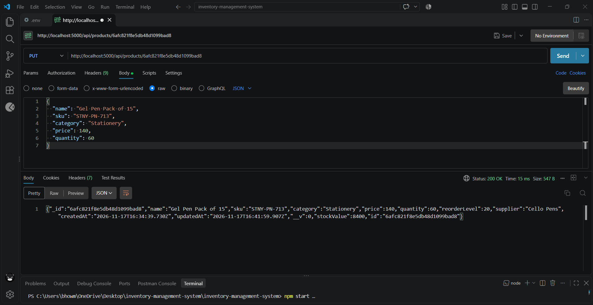
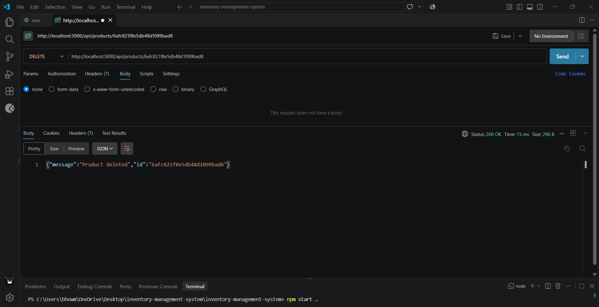
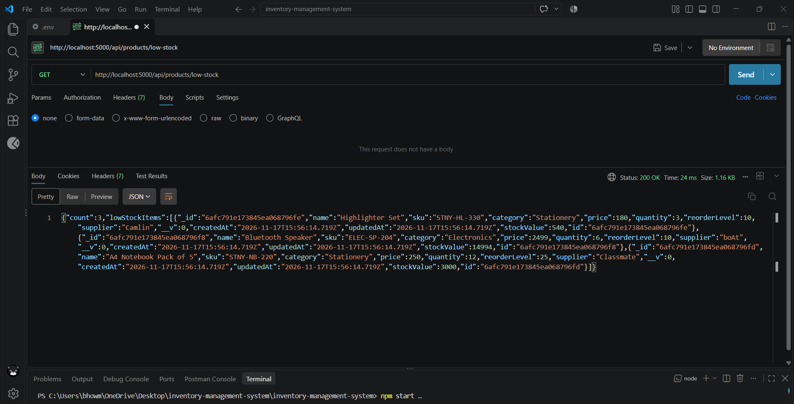

# Inventory and Data Management System

**Course:** Web Dev III | **Assignment 3** | **Unit 3 (CO3)**
**Student:** Bhowmik Vij | Roll No. 2501010195 | Section D | K.R. Mangalam University

## Postman Output Screenshots

### 1. Get all products (pagination)

### 2. Create product

### 3. Get single product by ID

### 4. Update product

### 5. Adjust stock (restock / sale)

### 6. Delete product

### 7. Low-stock alert report

### 8. Category-wise summary

### 9. Filtering, sorting and pagination

### 10. Validation error

