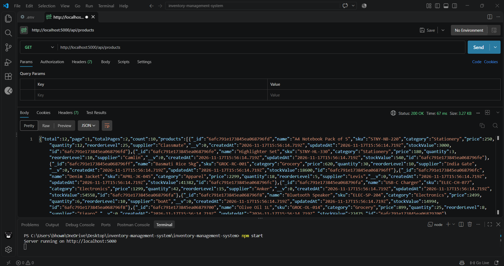
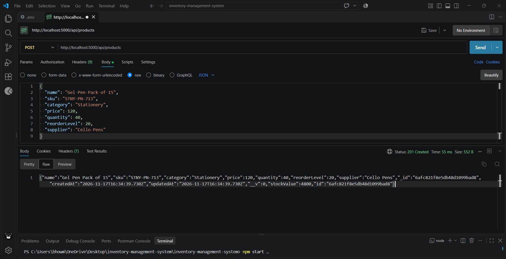
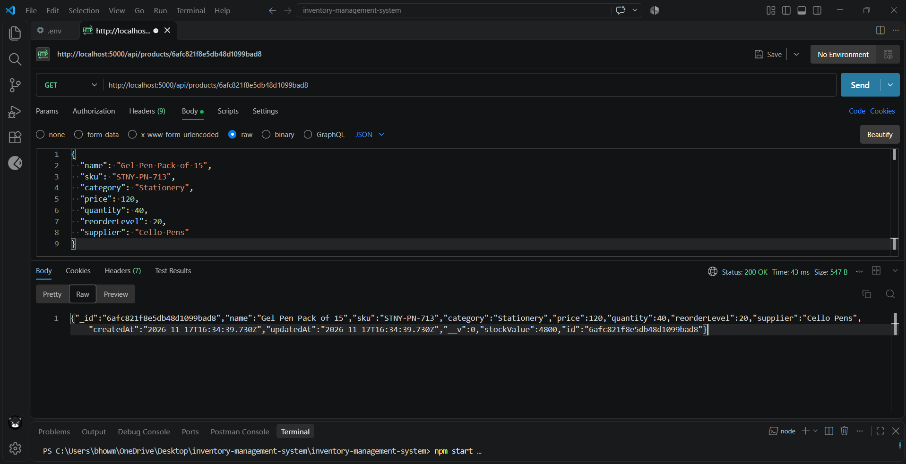
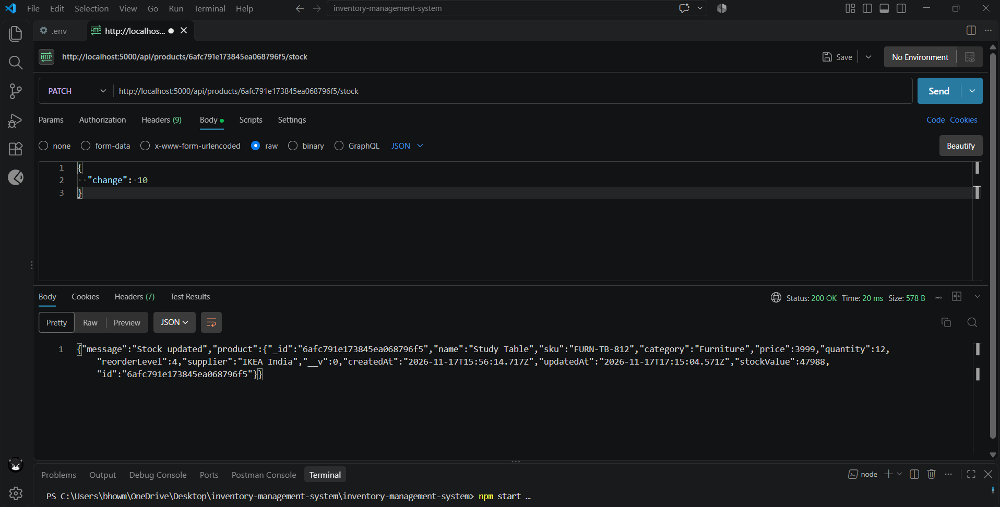
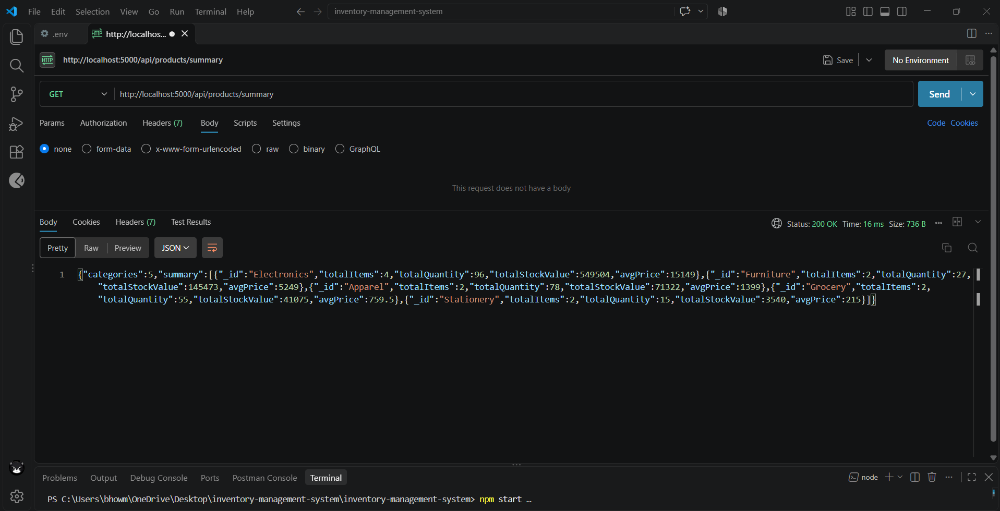
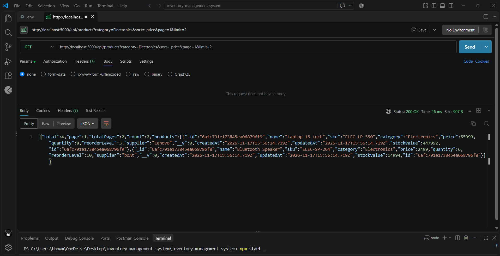
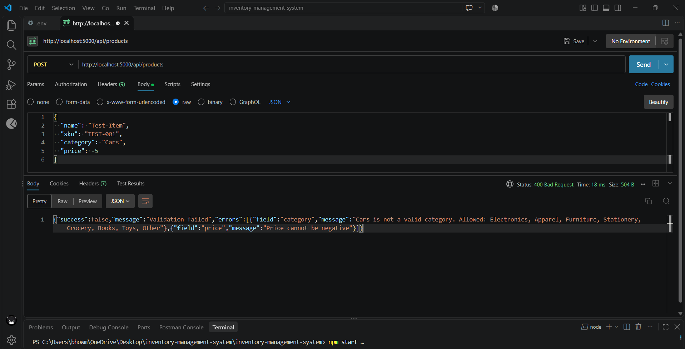

# Inventory and Data Management System

**Course:** Web Dev III | **Assignment 3** | **Unit 3 (CO3)**
**Student:** Bhowmik | Roll No. 2501010195 | Section D | K.R. Mangalam University

A RESTful backend for managing a product catalogue, built with **Node.js, Express.js, MongoDB (Mongoose) and dotenv**.
It supports CRUD, filtering, sorting, pagination, safe stock adjustment, and aggregation-based inventory reports.

## Project Structure

```
inventory-management-system/
├── config/db.js                    # MongoDB connection
├── controllers/productController.js
├── middleware/
│   ├── errorHandler.js             # Centralized error handling + 404
│   └── validators.js               # ObjectId, body and stock-change validation
├── models/Product.js               # Mongoose schema + validation
├── routes/productRoutes.js
├── utils/                          # AppError, asyncHandler
├── screenshots/                    # Postman output screenshots
├── seed.js                         # Sample data (12 products)
├── server.js
├── .env.example
└── package.json
```

## Setup and Run

1. Install dependencies: `npm install`
2. Copy `.env.example` to `.env` and set your values:
   ```
   PORT=5000
   MONGO_URI=mongodb://127.0.0.1:27017/inventory_db
   ```
3. (Optional) Load sample data: `npm run seed` (this deletes existing products first)
4. Start the server: `npm start`
5. API base URL: `http://localhost:5000/api/products`

## Product Schema

| Field | Type | Validation |
|---|---|---|
| name | String | required, trimmed, 2-100 chars |
| sku | String | required, **unique**, uppercased, letters/numbers/hyphens only |
| category | String | required, one of: Electronics, Apparel, Furniture, Stationery, Grocery, Books, Toys, Other |
| price | Number | required, min 0 |
| quantity | Number | whole number, min 0, default 0 |
| reorderLevel | Number | whole number, min 0, default 10 |
| supplier | String | optional, max 100 chars |
| stockValue | Virtual | `price x quantity` |
| createdAt / updatedAt | Date | automatic timestamps |

## API Endpoints

| Method | Endpoint | Description |
|---|---|---|
| POST | `/api/products` | Create a product |
| GET | `/api/products` | List products with filtering, sorting and pagination |
| GET | `/api/products/:id` | Get a single product |
| PUT | `/api/products/:id` | Update product details |
| PATCH | `/api/products/:id/stock` | Restock (`change` > 0) or sale (`change` < 0) |
| DELETE | `/api/products/:id` | Delete a product |
| GET | `/api/products/low-stock` | Products where `quantity <= reorderLevel` (aggregation) |
| GET | `/api/products/summary` | Category-wise inventory summary (aggregation) |

### Query parameters for `GET /api/products`

| Param | Example | Meaning |
|---|---|---|
| category | `?category=Electronics` | Exact category (case-insensitive) |
| supplier | `?supplier=ikea` | Partial supplier match |
| search | `?search=table` | Partial name match |
| minPrice / maxPrice | `?minPrice=500&maxPrice=3000` | Price range |
| inStock | `?inStock=true` | Only products with quantity > 0 |
| sort | `?sort=-price,name` | Sort fields (`-` = descending) |
| page / limit | `?page=2&limit=5` | Pagination (default limit 10, max 100) |

### Example request bodies

Create / Update:
```json
{ "name": "Gel Pen Pack of 15", "sku": "STNY-PN-713", "category": "Stationery", "price": 120, "quantity": 40, "reorderLevel": 20, "supplier": "Cello Pens" }
```

Adjust stock (negative value is a sale; stock can never drop below 0):
```json
{ "change": 10 }
```

### Error responses

All errors use one format, handled by the central error middleware:
```json
{ "success": false, "message": "Validation failed", "errors": [{ "field": "price", "message": "Price cannot be negative" }] }
```
400 = validation / bad input, 404 = not found, 409 = duplicate SKU.

## Postman Output Screenshots

### 1. Get all products (pagination)


### 2. Create product


### 3. Get single product by ID


### 4. Update product


### 5. Adjust stock (restock / sale)


### 6. Delete product


### 7. Low-stock alert report


### 8. Category-wise summary


### 9. Filtering, sorting and pagination


### 10. Validation error

